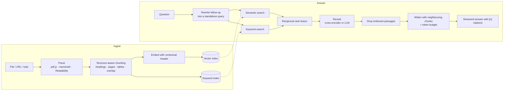
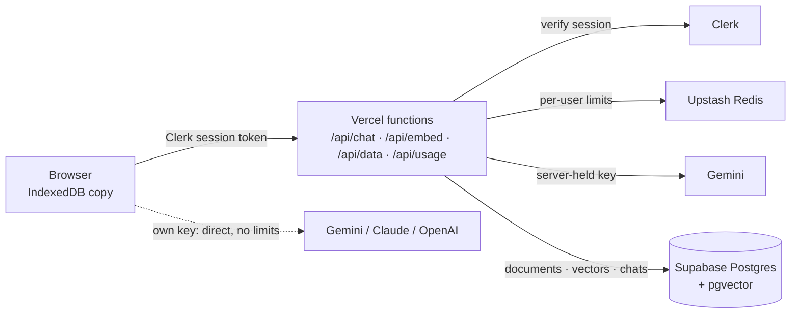

# CaptBot

A private research assistant that answers from **your own documents** and cites every claim. Run it on its own and everything stays in your browser. Sign in on a deployment with a database and your knowledge base lives in your account and syncs across your devices. Either way, only a question and the passages retrieved for it are sent to the model that answers.

## What it does

- **Knowledge base.** Add PDFs, Word documents, web pages, Markdown, text, CSV and JSON. Each is parsed, chunked, embedded and indexed.
- **Cited answers.** Answers cite retrieved passages inline, like `[1][3]`. Click a citation to open the source with the passage highlighted (with page numbers for PDFs).
- **Honest when the documents don't know.** Passages the reranker judges irrelevant are left out, so a question your documents don't cover gets "that's not in your documents" rather than loosely related excerpts.
- **Deep Research.** Plans 3–5 sub-questions, searches your documents for all of them in parallel, pools the evidence and writes a structured report with a summary, themed sections and gaps.
- **Collections.** Group documents into collections and scope any chat to one or more of them.
- **Backups and knowledge packs.** Export everything, or a single collection, to one `.captbot` file and import it on another device or share it.
- **Bring your own model.** Use Gemini, Claude, OpenAI or any OpenAI-compatible server (Ollama, LM Studio, OpenRouter). In the browser, embeddings and reranking can run fully on-device.
- **Accounts, a free tier and sync.** Sign in with a magic link, Google or GitHub. With server storage, documents, chats, collections and saved prompts live in your account and sync across devices. Signed-in users can chat on the app's own key with a daily allowance, or add their own key for unlimited use.

## The RAG pipeline



The indexes live in the browser (local mode) or in Postgres (server storage). Everything after fusion runs in the browser in both modes.

| Stage | How it works |
| --- | --- |
| Parsing | pdf.js extracts text and keeps page offsets. mammoth converts DOCX to HTML, and Readability + Turndown convert HTML to Markdown so headings survive. Tables in Word files and web pages become Markdown tables, so every row keeps its column names. CSV and JSON records become one self-describing `column: value` line per row. |
| Chunking | Markdown headings define sections that chunks never cross. Text is packed sentence by sentence to about 300 tokens, preferring paragraph breaks, with about 50 tokens of sentence-aligned overlap. Tables are never cut mid-row: one that fits stays whole, and a bigger one is split between rows with every part repeating the header. Sizes are counted in tokens, so Chinese, Japanese and Korean text gets proportionally shorter chunks. Every chunk stores its exact character span, heading path and page. |
| Embedding | Each chunk is embedded with a contextual header (`document › section`). In the browser, vectors are L2-normalised and tagged with the model that produced them, so a model change never mixes vector spaces. With server storage, every document is embedded on the server with `gemini-embedding-2` (768 dimensions), so all of an account's devices search one vector space. |
| Retrieval | Semantic and keyword search, fused with reciprocal rank fusion (k = 60). In the browser: exact cosine search over an in-memory `Float32Array` plus BM25 (MiniSearch, with prefix and fuzzy matching). On the server: pgvector HNSW search (with iterative scans, so the per-account filter doesn't cost recall) plus Postgres full-text search. Keyword search catches the names, codes and numbers that embeddings blur. |
| Reranking | A local `ms-marco-MiniLM-L-6-v2` cross-encoder running in a Web Worker (the default), LLM listwise reranking with the fast model, or none. The cross-encoder's order is blended with the retrieval order, so one bad score can't bury the passage that answers the question. It reads English, so questions in other scripts are reranked by the chat model instead. |
| Relevance filter | Passages the cross-encoder gives under 1% relevance, or that the LLM reranker leaves out, are dropped. When nothing is left, the model is told the documents don't cover the question. The answer's trace says how many weak matches were left out. |
| Context | Hits go in best first. While the token budget allows, each is widened with the chunk before and after it, and chunks that touch merge into one excerpt, so the model reads whole passages rather than fragments. Sources are numbered and wrapped in `<source>` tags that the system prompt marks as untrusted data, which guards against prompt injection hidden in documents. |
| Follow-ups | A follow-up such as "what about the second one?" is rewritten into a standalone query before searching. |
| Citations | `[n]` markers are parsed out of the answer, mapped back to chunks, and rendered as clickable chips and source cards. Retrieved-but-uncited passages stay available but are listed separately. |
| Transparency | Each answer shows the query that was actually searched, the candidate count, the reranker used, how many passages were left out and the latency, plus warnings (for example "keyword search only"). |
| Evaluation | A retrieval test set (16 questions over five realistic documents, tables included) runs with the unit tests and fails if any answering passage goes missing. |

## Providers

| Provider | Chat | Embeddings | Web search |
| --- | --- | --- | --- |
| Google Gemini | Yes | `gemini-embedding-2` | Yes (Google Search grounding) |
| Anthropic Claude | Yes | – | – |
| OpenAI | Yes | `text-embedding-3-*` | – |
| OpenAI-compatible (Ollama, LM Studio, OpenRouter…) | Yes | Yes | – |
| Local, in-browser | – | `bge-small-en-v1.5` | – |

Chat and embeddings are configured independently. For example, you can chat with Claude while embedding locally. Model names are free-text fields with presets, so new model IDs work without a code change. With server storage, the embedding settings don't apply: the server indexes every account with one model.

## Getting started

```bash
npm install
npm run dev
```

Open http://localhost:3000, click **Settings**, and paste an API key for the provider you want. Then open **Knowledge** in the sidebar, add some documents, and ask a question.

This is local mode: with no Clerk key configured there is no sign-in, no free tier and no server storage, and no `.env` file is needed. To run with accounts and sync, see [Accounts, storage and limits](#accounts-storage-and-limits).

To run fully offline with Ollama, set the chat provider and embeddings to **OpenAI-compatible**, point them at `http://localhost:11434/v1`, and start Ollama with `OLLAMA_ORIGINS` allowing your site's origin.

## Deploying

```bash
npm run build   # type-checks, then writes dist/
```

Deploy to Vercel. The app is a static site plus four functions in `api/`. Without any environment variables it runs in local mode, where every visitor brings their own key and keeps their data in their browser. `vercel.json` pins the functions to Mumbai (`bom1`), next to the database; change `regions` if your database lives elsewhere.

> **Upgrading from v1?** The old build embedded `GEMINI_API_KEY` in the public JavaScript bundle, so anyone could read it. Rotate that key. In v2 the variable is read only by the server functions and never reaches the browser (only `VITE_`-prefixed variables do).

## Accounts, storage and limits



- **Sign-in** uses Clerk: magic link, Google or GitHub. The browser sends a short-lived session token with every API call, and the functions verify it.
- **Server storage.** When `DATABASE_URL` is set, a signed-in user's collections, documents (text, chunks and vectors), chats and saved prompts live in Postgres, one set of rows per account.
  - The browser keeps an IndexedDB copy so the app stays fast. It pushes its own changes and pulls other devices' changes on load, on focus, every minute and shortly after each edit. An edit that hasn't been uploaded yet always wins over a pulled one.
  - Pulls follow the order of the database transactions that wrote each row, and only see transactions that have finished, so a slow write is never skipped. A change the server can't store is reported in Settings and doesn't hold up the rest.
  - Files are still parsed and chunked in the browser. The server embeds and indexes the chunks, and knowledge-base searches run on the server.
  - Images attached to messages stay on the device that sent them.
  - The first time an account signs in on a browser that already had data, that data moves into the account.
  - Settings, including API keys, are per browser and never synced.
- **Without `DATABASE_URL`**, everything stays in each browser, kept separate per account.
- **Free tier.** Signed-in users without their own key chat on the server's Gemini key. Limits are enforced on the server per user. By default:
  - 10 AI calls a minute and 100 a day;
  - 60 indexing requests a minute and 300 a day (each covers up to 64 chunks with server storage, 100 otherwise);
  - 60 knowledge-base searches a minute and 1,000 a day (server storage only);
  - 120 saves a minute and 5,000 a day (server storage only: sync uploads, new documents and their text).

  Daily allowances reset at 00:00 UTC. The sidebar and Settings show what's left. With server storage each account can also hold up to 100 million characters of document text (`STORAGE_MAX_CHARS`).
- **Own keys.** A user who adds their own key in Settings calls that provider directly from the browser, with no CaptBot limits on chat. With server storage, indexing and search still run on the server and count toward those allowances.
- **Fails closed.** If Clerk, the Gemini key or (in production) Upstash is missing, the functions refuse requests instead of serving unauthenticated or unlimited calls. Without a database, storage requests are refused and the app stays in browser storage.

### Setup

1. **Clerk:** create an application at clerk.com.
   - Under **User & Authentication**, enable sign-in with email and turn on **Email verification link**.
   - Under **SSO connections**, add **Google** and **GitHub**. Development instances use Clerk's shared OAuth credentials; production needs your own OAuth client ID and secret for each.
2. **Upstash:** create a Redis database, or add the Upstash integration from the Vercel Marketplace, which sets `KV_REST_API_URL` and `KV_REST_API_TOKEN` for you.
3. **Supabase (server storage):** use an existing project or create one, then run the SQL files in [`supabase/migrations`](supabase/migrations) in order (SQL editor, or `supabase db push`).
   - Everything goes into a `captbot` schema that the Supabase Data API doesn't expose; only the CaptBot API reaches it.
   - Copy the **Transaction pooler** connection string (Connect → Transaction pooler, port 6543). That's `DATABASE_URL`.
4. **Vercel → Settings → Environment Variables:** add the variables from [`.env.example`](.env.example):
   - `VITE_CLERK_PUBLISHABLE_KEY` and `CLERK_SECRET_KEY`
   - `CLERK_AUTHORIZED_PARTIES`: your site's origin
   - `GEMINI_API_KEY`
   - `DATABASE_URL`
   - the Upstash pair
   - optionally, the `FREE_*` limits and models
5. Redeploy.

To run locally with accounts, copy `.env.example` to `.env.local`, fill it in and run `npm run dev`. The dev server serves the `api/` functions as well, reading server variables from `.env.local`.

Without Upstash outside production, limits fall back to an in-memory counter. That's fine for trying things out but not shared between function instances.

## Privacy and security

- **Local mode.** Documents, chunks, vectors, chats and saved prompts live in your browser's IndexedDB, separated per signed-in account. The server functions store nothing but rate-limit counters.
- **Server storage.** Documents (text, chunks and vectors), chats, collections and saved prompts are stored in your account's rows in Postgres.
  - Every query the API runs is scoped to the signed-in user.
  - The schema isn't exposed through Supabase's Data API, and row-level security is enabled on every table as a backstop.
  - Image attachments aren't uploaded.
  - Deleting all data removes it from the account on every device.
- **Your own API keys** are stored in `localStorage` for your account, are never synced, and are sent only to the provider they belong to. The free tier's key never leaves the server.
- **Network access** only goes to:
  - your CaptBot deployment's API;
  - the chat and embedding providers you configure;
  - `huggingface.co`, for a one-time model download if you use local embeddings or reranking;
  - pages you import, plus an optional reader proxy you set;
  - Google Fonts.
- **Prompt-injection hardening.** Retrieved text is fenced and explicitly treated as untrusted data.

## What changed in v2

**Removed**
- The scripted "Thinking Process" log, mock RUN button, unused boot sequence and cache service, static Explore/"Pro Features" tab, and non-functional ⌘K search.
- Regex-triggered image generation, voice input, and the unreachable maps/geolocation mode.
- Build-time API key injection, the localStorage vector index, the CDN Tailwind script and the AI Studio import map.

**Rebuilt**
- History is now real, persistent chat threads you can reopen, rename and delete.
- Saved prompts insert into the composer.
- Pinned messages feed the context.
- Copy and Regenerate work.
- Web search (Gemini), image attachments, charts from JSON answers, dark mode, fonts and Export to Docs are kept.

**Added**
- The RAG pipeline above, including the relevance filter, excerpt widening, table-aware and CJK-aware chunking, and a retrieval test set.
- Multi-format and URL ingestion.
- The citation viewer, Deep Research with parallel searches, collections, backups and knowledge packs, and pluggable providers with local embeddings and reranking.
- Accounts, a rate-limited free tier, and server storage with sync across devices.

## Development

```bash
npm test            # Vitest: chunker, search, retrieval quality, citations, parsers, sync, API, end-to-end pipeline, packs
npm run typecheck
npm run build
```

```
api/              Vercel functions: chat, embed, data (server storage and search), usage
  _lib/           handlers, Clerk auth, Upstash limits, Gemini, Postgres store
supabase/
  migrations/     schema for server storage
src/
  lib/
    auth/         session, per-account profile storage, free-tier usage
    rag/          chunker, parsers, ingest, lexical + vector indexes, fusion, retrieve, answer, citations, eval
    sync/         server storage: change tracking, push/pull, uploads, server search
    providers/    gemini, anthropic, openai (+compatible), local (transformers.js worker client)
    kb/           backup / knowledge-pack format
    db.ts         IndexedDB schema (Dexie)
    settings.ts   provider, model and retrieval settings
    prompts.ts    system and utility prompts
  workers/        local embedding + cross-encoder worker
  components/     sidebar, knowledge panel, chat, source viewer, settings
  hooks/useChat.ts
```

## License

MIT
